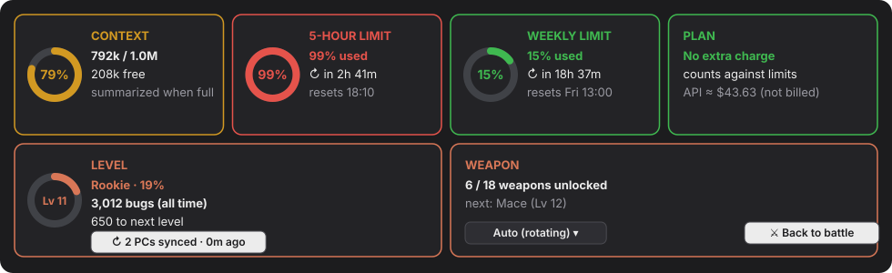

# ⚔ Task Bar Claude

> **Unofficial.** A community plugin for Claude Code. It is not made, endorsed or supported by Anthropic. *Gayriresmi: Anthropic ile bağlantısı olmayan bir topluluk eklentisidir.*

**Claude fights bugs above your prompt while it works.** A smooth animated arena for Claude Code, with levels, 18 weapons, a campfire between turns, and a live readout of your context window, usage limits and plan.



[Türkçe açıklama aşağıda ↓](#-türkçe)

## Why use it

Claude Code shows you little of what you are spending while it works. Task Bar Claude keeps it all one click away, above the prompt:



- **Know before you hit a wall.** Ring charts for the context window and the 5-hour and weekly limits, with the exact reset time. You see 99% coming before a request is refused.
- **No false alarms about money.** On a Pro or Max subscription it says *no extra charge*. The dollar figure Claude Code tracks is only what the same work would cost through the API, and here it is labelled as such.
- **Context that fills up is no surprise.** You see how many tokens are free before older messages get summarized.
- **Waiting is fun.** While Claude works, it fights. Your level and weapons grow with every session, on every computer you use.


## Install

In a Claude Code **terminal** session:

```
/plugin install taskbar-claude --marketplace dogiergin/taskbar-claude
```

Answer `y` to add the marketplace, then pick the **user** scope (Enter). The band appears above the prompt at once, and in every session after: terminal, the desktop app's Code tab and VS Code alike.

Needs Claude Code **2.1.287 or later** (mods).

## What you get

- **A fight that never restarts.** From the moment you send a prompt until Claude is done, the scene plays as one continuous, smooth loop: bugs come at irregular times and Claude meets each with the strike that suits it: slash, jump chop, spin or dash thrust.
- **Four kinds of bugs:** spiked beetles, eight-legged spiders, two-legged four-armed mantises and wasps in the air.
- **Melee or ranged.** Switch with the **STYLE** chip: blades, or guns with muzzle flash, tracers and recoil.
- **18 weapons** unlocked by level: katana, longsword, battle axe, mace, scimitar, warhammer, spear, halberd, trident, scythe, the legendary dragon and frost blades; Walther PPK (007), Desert Eagle, dual Berettas, AK-47, minigun and a space blaster.
- **100 levels and ranks:** Rookie, Mid (30), Experienced (70) and Legend (100). Gear comes with rank: a headband at 30, helm, cape and shield at 70, gold at 85, a crown at 100.
- **A camp between turns.** Claude sleeps in a bedroll when a session starts, wakes on your first prompt, and rests by the campfire with a dog and a cat between turns.
- **Token snacks.** Now and then Claude taps the usage bar and eats a piece of the context block.
- **Live usage at a glance:** context fill, the 5-hour and weekly limits with their reset countdowns, and your plan. On a subscription it says *no extra charge* instead of showing an API-price dollar figure that is not a bill.
- **Turkish or English,** following the language you write to Claude in.

| | |
|---|---|
|  |  |
|  |  |

## Where it draws

| Surface | Scene | Summary chips | Details panel |
|---|---|---|---|
| Desktop app (Code tab) | Smooth vector scene | Click anywhere in a chip | Ring charts, weapon menu |
| VS Code | Smooth vector scene | Buttons | Ring charts, weapon menu |
| Terminal | Pixel scene | Buttons (`ctrl+x tab`, digit hotkeys) | Bars, weapon menu |
| Mobile | Smooth vector scene | Buttons, two to a row | Ring charts, weapon buttons |
| `claude -p`, SDK | Nothing drawn; counting goes on | | |

## Kill count across computers (optional)

Your level lives in a small file under `~/.claude` on each computer. Every Claude Code session on that computer shares it.

To share it **between computers**, open the details and press **↻ PC sync** on the LEVEL card (or set the plugin's `sync` option to `on`). It keeps one private gist named `taskbar-claude sync` in your GitHub account, through the [GitHub CLI](https://cli.github.com/) (`gh auth login`; no token passes through the plugin). Each computer only ever raises its own count, and the total is their sum, so nothing is counted twice or lost.

## Settings

| Option | Values | Default |
|---|---|---|
| `language` | `auto`, `tr`, `en` | `auto` |
| `sync` | `off`, `on` | `off` |

## Safety

Like every Claude Code mod, this one runs with your permissions. It draws, counts and keeps its own small store. It runs one program, `gh`, and only when you turn sync on. Read the code in `hooks/`, or check what it uses with:

```
claude plugin validate <folder>
```

## Develop

```
claude plugin validate .
claude plugin test .
```

---

## 🇹🇷 Türkçe

**Claude çalışırken prompt kutusunun üstünde böceklerle savaşıyor.** Claude Code için akıcı animasyonlu bir arena: seviyeler, 18 silah, turlar arasında kamp ateşi ve bağlam penceresi, kullanım limitleri ve planın canlı göstergesi.

### Kurulum

Bir Claude Code **terminal** oturumunda:

```
/plugin install taskbar-claude --marketplace dogiergin/taskbar-claude
```

Marketplace'i eklemek için `y`, sonra **user** kapsamını seçin (Enter). Bant hemen ve sonraki tüm oturumlarda görünür: terminal, masaüstü uygulamasının Code sekmesi ve VS Code.

Claude Code **2.1.287 veya üstü** gerekir.

### Neden kullanmalı

Claude Code çalışırken ne kadar harcadığınızı pek göstermez. Task Bar Claude hepsini prompt'un üstünde, tek tıkla gösterir:


- **Duvara çarpmadan görün:** Bağlam penceresi, 5 saatlik ve haftalık limitler halka grafiklerle, sıfırlanma saatleriyle birlikte.
- **Para konusunda yanlış alarm yok:** Abonelikte *ek ücret yok* yazar. Claude Code'un tuttuğu dolar tutarı yalnızca API fiyatıyla karşılığıdır ve öyle etiketlenir.
- **Beklemek eğlenceli:** Claude çalışırken savaşır; seviyeniz ve silahlarınız her oturumda, her bilgisayarda büyür.

### Neler var

- **Hiç baştan başlamayan savaş:** Prompt'u gönderdiğiniz andan iş bitene kadar sahne tek, kesintisiz bir döngü. Böcekler düzensiz aralıklarla gelir, Claude her birini ona uygun vuruşla karşılar.
- **Yakın / Uzak:** **MOD** kutusuyla kılıçlar ile silahlar arasında geçiş yapılır.
- **18 silah**, **100 seviye**, rütbeler: Çaylak, Orta (30), Deneyimli (70), Efsane (100). Rütbeyle gelen kıyafetler: Sv 30'da bant, Sv 70'te miğfer, pelerin ve kalkan, Sv 85'te altın, Sv 100'de taç.
- **Kamp:** Oturum başında uyku, ilk prompt'ta uyanış, turlar arasında köpek ve kediyle ateş başında dinlenme.
- **Kullanım göstergesi:** Bağlam, 5 saatlik ve haftalık limitler. Abonelikte faturaymış gibi görünen dolar tutarı yerine *ek ücret yok* yazar.
- Claude'a yazdığınız dile göre **Türkçe ya da İngilizce**.

### Bilgisayarlar arası sayım (isteğe bağlı)

Detaylarda SEVİYE kartındaki **↻ PC senkronu** düğmesine basın. GitHub hesabınızda gizli bir `taskbar-claude sync` gist'i tutulur; [GitHub CLI](https://cli.github.com/) (`gh auth login`) gerekir. Her bilgisayar yalnızca kendi sayacını artırır, toplam hepsinin toplamıdır: hiçbir şey iki kez sayılmaz ya da kaybolmaz.

## License

MIT
